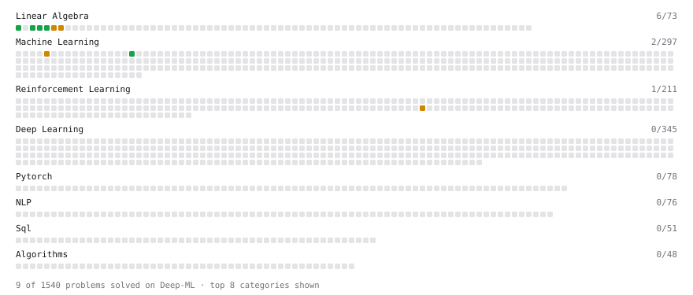

# Deep-ML

My machine learning practice from [Deep-ML](https://www.deep-ml.com). Every solution here was written by hand.

**12** solved · 12 problems · 0 labs · 0 math

[**Browse the interactive portfolio**](https://pidneuralode.github.io/deep-ml/) to replay this filling in over time.

## Problems

| | Difficulty | Solved | |
| --- | --- | --- | --- |
| [Calculate Mean by Row or Column](https://www.deep-ml.com/problems/4) | easy | 2026-10-11 | [solution](problems/0004-calculate-mean-by-row-or-column) |
| [Implement Ridge Regression Loss Function](https://www.deep-ml.com/problems/43) | easy | 2026-10-14 | [solution](problems/0043-implement-ridge-regression-loss-function) |
| [Matrix-Vector Dot Product](https://www.deep-ml.com/problems/1) | easy | 2026-10-10 | [solution](problems/0001-matrix-vector-dot-product) |
| [Reshape Matrix](https://www.deep-ml.com/problems/3) | easy | 2026-10-10 | [solution](problems/0003-reshape-matrix) |
| [Scalar Multiplication of a Matrix](https://www.deep-ml.com/problems/5) | easy | 2026-10-11 | [solution](problems/0005-scalar-multiplication-of-a-matrix) |
| [Array Drills: Product Except Self, 3Sum, Find Peak, Maximum Swap](https://www.deep-ml.com/problems/1173) | medium | 2026-10-15 | [solution](problems/1173-array-drills-product-except-self-3sum-find-peak-maximum-swap) |
| [Calculate Eigenvalues of a Matrix](https://www.deep-ml.com/problems/6) | medium | 2026-10-12 | [solution](problems/0006-calculate-eigenvalues-of-a-matrix) |
| [Deep and Cross Network: Cross Layers v1 and v2](https://www.deep-ml.com/problems/1403) | medium | 2026-10-14 | [solution](problems/1403-deep-and-cross-network-cross-layers-v1-and-v2) |
| [Implement K-Fold Cross-Validation](https://www.deep-ml.com/problems/18) | medium | 2026-10-13 | [solution](problems/0018-implement-k-fold-cross-validation) |
| [Matrix Transformation ](https://www.deep-ml.com/problems/7) | medium | 2026-10-12 | [solution](problems/0007-matrix-transformation) |
| [Multi-Token Prediction Training Objective](https://www.deep-ml.com/problems/745) | medium | 2026-10-18 | [solution](problems/0745-multi-token-prediction-training-objective) |
| [Policy Gradient with Softmax Action Selection](https://www.deep-ml.com/problems/616) | medium | 2026-10-13 | [solution](problems/0616-policy-gradient-with-softmax-action-selection) |

---

_This file is regenerated by Deep-ML on every push._
